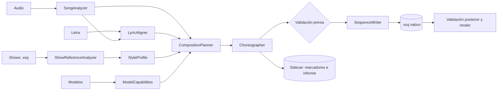

# Arquitectura propuesta — Juajilandia Show Composer

Las evidencias de código están en `AUDITORÍA_TÉCNICA.md`. Los contratos de datos completos están en
`MODELO_DE_DATOS.md`.

## 1. Decisión central

**El Composer es una tubería de etapas puras dentro de `src-core/composer/`. Produce un plan de datos
versionado, y un único módulo convierte ese plan en objetos nativos de xLights.**

Esta forma generaliza `MovingHeadSong::Generate`, que ya está aceptada en el proyecto. Aporta cuatro
cosas:

- Lo pesado corre fuera del hilo de interfaz, porque no toca el modelo vivo.
- El plan se puede probar y comparar sin renderizar.
- La reproducibilidad se verifica comparando el hash del plan.
- El iPad y el modo headless reutilizan todo menos la interfaz.



### Validación de la lista de módulos solicitada

| Módulo pedido | Decisión | Motivo |
|---|---|---|
| A. Music Analysis | Se mantiene como `SongAnalyzer` | Orquesta detectores existentes y añade los que faltan |
| B. Lyric Synchronization | Se mantiene como `LyricAligner` | Con proveedores |
| C. Show Reference Analyzer | Se mantiene | Solo lectura |
| D. Style Profile | Se mantiene como datos | Sin clase con lógica propia |
| E. Model Capability Registry | Se mantiene como `ModelCapabilities` | |
| F y G. Planner y Choreography | **Se mantienen separados** | F decide "qué y quién" sin plantillas; G concreta efectos. Se prueban por separado |
| H. Media Cue Manager | **Se reduce** | Son datos y funciones de escritura y lectura, no un gestor con estado |
| I. Sequence Generator | Se mantiene como `SequenceWriter` | Único que toca `SequenceElements` |
| J. Validation and Reporting | Se mantiene | Reutiliza `CheckEffectSettings` |
| K. User Interface | Se mantiene en `src-ui-wx/composer/` | |

Son **funciones libres en el namespace `composer`**, igual que `MovingHeadSong`. No hay servicios,
singletons, registros dinámicos ni sistema de plugins: una sola tubería no los justifica.

## 2. Estructura de archivos

```
src-core/composer/
  ComposerTypes.h          enums, ProgressSink, CancelToken, ComposerMessage
  ComposerJson.h/.cpp      serialización JSON de todos los contratos
  SongAnalysis.h/.cpp      SongAnalyzer + MusicalEvent
  LyricDocument.h/.cpp     texto → estrofas, frases, palabras
  LyricAligner.h/.cpp      proveedores de alineación
  SpanishPhonemizer.h/.cpp español → Preston Blair
  ModelCapabilities.h/.cpp roles y capacidades
  ShowReference.h/.cpp     extracción de características de .xsq
  StyleProfile.h/.cpp      perfil y agregación
  CompositionPlan.h/.cpp   planificador global
  Choreography.h/.cpp      eventos concretos + plantillas
  MediaCue.h/.cpp          marcadores
  SequenceWriter.h/.cpp    plan → objetos nativos (único con dependencia del modelo vivo)
  GenerationValidator.h/.cpp
  ComposerRunner.h/.cpp    orquesta las etapas
src-ui-wx/composer/
  ShowComposerDialog.h/.cpp       asistente
  ComposerReviewPanel.h/.cpp      revisión y recursos pendientes
  ComposerMessages.cpp            ComposerMessage → texto traducido
resources/composer/
  templates/*.json         plantillas de efectos
  profiles/*.json          perfiles de partida
```

También hay que retocar, en cantidad mínima:

- `src-core/lyrics/LyricBreakdown.*`: extraer el reparto de tiempos (sección 6).
- `src-ui-wx/xLightsMain.cpp` y `.h`: entrada de menú.
- `src-ui-wx/xLightsApp.cpp`: opción de desarrollo `--compose`.

## 3. Interfaces

Estas firmas son **propuestas**. Todo lo que no sea `composer::` existe en el repositorio.

```cpp
namespace composer {

struct CancelToken { const std::atomic<bool>* flag = nullptr; bool Cancelled() const; };
using ProgressFn = std::function<void(Stage stage, int percent)>;

SongAnalysis AnalyzeSong(AudioManager& privateAudio, const AnalysisOptions&,
                         ProgressFn, CancelToken);

LyricDocument ParseLyrics(const std::string& text, const std::string& languageTag);
LyricAlignment AlignLyrics(const LyricDocument&, const SongAnalysis&, AudioManager& privateAudio,
                           const AlignmentOptions&, ProgressFn, CancelToken);

std::vector<ModelCapabilities> DescribeModels(const ModelManager&,
                                              const std::vector<RoleOverride>&);

ShowFeatures ExtractShowFeatures(xLightsShowContext&, const ShowReference&, CancelToken);
StyleProfile BuildProfile(const std::vector<ShowFeatures>&, const StyleProfile* base);

CompositionPlan PlanComposition(const SongAnalysis&, const LyricAlignment*, const StyleProfile&,
                                const std::vector<ModelCapabilities>&, const GenerationOptions&);
Choreography Choreograph(const CompositionPlan&, const StyleProfile&,
                         const TemplateLibrary&, const GenerationOptions&);

ValidationResult ValidatePlan(const Choreography&, const std::vector<ModelCapabilities>&);

// Solo hilo principal. Es la única etapa que toca SequenceElements.
WriteResult WriteToSequence(xLightsShowContext&, const Choreography&, const LyricAlignment*,
                            const PhonemeSource&, const WriteOptions&);

ValidationResult ValidateWritten(xLightsShowContext&, const std::string& xsqPath);
}
```

### Por qué no se usa `RenderContext::AddTimingElement`

`HeadlessRenderContext` devuelve `nullptr`. Tampoco se debe cambiar ese comportamiento por efectos
colaterales. `SequenceWriter` usará el mismo cuerpo que el iPad (`SequenceElements::AddElement` +
`AddEffectLayer` + `AddTimingToCurrentView`), en una función auxiliar del núcleo.

## 4. Ruta de ejecución

```
Hilo trabajador (sin tocar el modelo vivo):
  AudioManager privado → AnalyzeSong → AlignLyrics → DescribeModels*
  → PlanComposition → Choreograph → ValidatePlan
Hilo principal:
  CloseSequence (con confirmación) → crear .xsq nuevo → abrir
  → WriteToSequence → guardar → ValidateWritten → abrir en el secuenciador
```

*`DescribeModels` lee `ModelManager`. Se ejecuta en el hilo principal **antes** de arrancar el trabajador
y le pasa una copia de datos planos. Así el trabajador nunca toca objetos vivos.

### Concurrencia

- Un `std::thread` por ejecución, con `std::atomic<bool>` y progreso, siguiendo
  `src-ui-wx/sequencer/Waveform.cpp:950-959`.
- `parallel_for` dentro de los algoritmos.
- **`JobPool` no se usa:** está dimensionado para el render y mezclar colas complicaría la cancelación.
- **Cancelación:** cada etapa comprueba el token entre bloques. Como solo `WriteToSequence` toca el modelo
  vivo y es corta, cancelar durante el análisis no puede dejar la aplicación inconsistente.
  `WriteToSequence` no se puede cancelar.
- **Interfaz:** en el asistente, durante el análisis se bloquea solo el propio diálogo. El reproductor no se
  ve afectado, gracias a la instancia privada de `AudioManager`.
- El Composer requiere guardar y cerrar la secuencia abierta **solo en el paso final**.

## 5. Persistencia

**Regla: si el secuenciador lo debe ver, va en objetos nativos. El resto va en archivos propios. Nada se
guarda en `xlights_rgbeffects.xml` ni en `xlights_networks.xml`.**

| Dato | Dónde | Por qué |
|---|---|---|
| Efectos, capas, paletas | `.xsq` | Nativo |
| Pistas (beats, compases, ataques, secciones, letra) | Pistas de tiempos en `.xsq` | Nativo y editable |
| Secciones (visual) | `SongStructureManager` en `.xsq` | Regiones de colores que ya existen |
| Marcadores (visible) | Pista de tiempos en `.xsq` | Sobrevive aunque se pierda el sidecar |
| Marcadores (detalle) | `<secuencia>.composer.json` junto al `.xsq` | No cabe en una etiqueta |
| Procedencia e informe | `<secuencia>.composer.json` | Versión, semilla, hash |
| Perfiles de estilo | `<show>/ShowComposer/profiles/<id>.json` | Editable y versionado |
| Catálogo de referencias | `<show>/ShowComposer/references.json` | Clasificación de cada show |
| Correcciones aprendidas | `<show>/ShowComposer/profiles/<id>.changes.json` | Separadas para aceptar o descartar |
| Roles de modelos | `<show>/ShowComposer/roles.json` | No se tocan los modelos |
| Caché de análisis | `<show>/ShowComposer/cache/<hash-audio>.analysis.json` | Se puede borrar |
| Preferencias de interfaz | `GetXLightsConfig()` | Igual que `InterfaceLanguage` |

### Alternativas descartadas para los metadatos

| Alternativa | Motivo |
|---|---|
| Nodo propio dentro del `.xsq` | `BuildDocument` lo eliminaría, y ampliar `SequenceFile` crea un formato que el xLights oficial borraría al guardar |
| Efecto Video vacío o falso | `VideoEffect::CheckEffectSettings` lo marca como error; lo prohíbes expresamente |
| Base de datos SQLite | Dependencia injustificada para pocos archivos |
| Efecto nuevo tipo "marcador" | Exige tocar el motor de render y abre un formato que el xLights oficial no entiende |

### Compatibilidad de la secuencia generada

El `.xsq` generado es válido en un xLights oficial de la misma versión, porque solo usa objetos nativos.
Sin el sidecar se pierde el detalle de los marcadores, pero no la secuencia ni su pista de marcadores.

### Cómo se aísla el show original

- `ExtractShowFeatures` sigue el patrón de `ImportEffects.cpp:285-297`, con `SequenceElements` propio y
  sin llamar nunca a `Save`.
- Una prueba compara el SHA-256 de los archivos de referencia antes y después.

### Seguridad al guardar

`SequenceFile::Save` no es atómico, así que:

1. El nombre destino no debe existir; si existe, se añade un sufijo, **nunca se sobrescribe**.
2. Se guarda en `<nombre>.composer-tmp.xsq`.
3. Se reabre y se valida.
4. Solo entonces se renombra.
5. Si el usuario pide sustituir una secuencia suya, debe confirmarlo y antes se crea una copia con fecha.

## 6. Letras y fonemas

### Proveedores

Se prueban en orden, y cada resultado lleva su `source` y su `confidence`:

| Prov. | Fuente | Implementación | Confianza |
|---|---|---|---|
| A | Pista ya existente, `.xtiming`, `.pgo`, `.srt`, `.lrc` | Reutiliza `SequenceFile::Process*` y `ParseLRC` | Alta |
| D | Marcado manual: el usuario pulsa una tecla en cada frase mientras suena | Nuevo modo en el asistente, inspirado en `TIMING_ADD` | Alta en frases |
| B | Whisper local, si existe | `aiBase::GenerateLyricTrack` como **anclas**: alineación secuencial entre lo transcrito y la letra | Media |
| C | Actividad vocal + sílabas | **Nuevo**, programación dinámica sobre la pista vocal | Baja a media |
| — | Reparto uniforme | Último recurso | Muy baja, siempre con aviso |

**El proveedor C es la ruta por defecto en Windows hoy.** Su calidad real es desconocida hasta medirla; ver
`PROPUESTA_DE_PRIMER_MVP.md`. Por eso el marcado manual es un proveedor de primer nivel y no un parche.

### Proveedor C, en resumen

1. Envolvente vocal con `STEM_VOCALS` si existe, y si no con `VOCALS` (extracción del canal central).
2. Detección de segmentos de voz por energía, con histéresis.
3. Las frases se asignan a los segmentos por programación dinámica, usando el número de sílabas como coste.
4. Dentro de cada frase, las palabras se reparten por sílabas y se ajustan a los ataques cercanos.

### Español

`SpanishPhonemizer` es un conversor por reglas de español a Preston Blair. El español tiene una ortografía
muy regular, así que no hace falta ningún diccionario ni modelo:

| Grafía | Fonema |
|---|---|
| `a` | `AI` |
| `e`, `i` | `E` |
| `o` | `O` |
| `u` | `U` |
| `m`, `b`, `p`, `v` | `MBP` |
| `f` | `FV` |
| `l`, `ll` | `L` |
| `w`, `hu` + vocal | `WQ` |
| `h` muda | (nada) |
| Resto | `etc` |

La tabla es **propuesta**, y debe validarse viendo las caras reales.

### Selección de idioma

| Caso | Tratamiento |
|---|---|
| Letra `es` | `SpanishPhonemizer` directamente, **sin consultar** el diccionario CMU (`AMOR` y `CORAZON` están en inglés ahí) |
| Letra `en` | `PhonemeDictionary` tal como está; las palabras sin entrada se informan |
| Mezcla | Idioma por bloque en `LyricDocument` |

### Cambio mínimo en el código existente

Se extrae de `BreakdownWord` el reparto de tiempos en una función nueva que recibe la lista de fonemas ya
resuelta. El comportamiento de la función actual no cambia. Se descartó `PhonemeDictionary::InsertPhoneme`
porque contaminaría el diccionario de la sesión del usuario.

### Varias voces

`LyricDocument.blocks[].voice` identifica cada voz. Cada voz produce su propia pista de 3 capas, y
`GenerationOptions.voiceAssignments` asigna voz a modelo o grupo. El MVP usa una sola voz, pero el formato no
tendrá que cambiar. El efecto `Faces` ya lo permite, porque cada efecto apunta a una pista
(`E_CHOICE_Faces_TimingTrack`).

## 7. Análisis musical

| Característica | Fuente | Estado |
|---|---|---|
| Duración, frecuencia | `AudioManager` | Existe |
| Ataques | `DetectOnsets` | Existe |
| Tempo global | `DetectTempo` | Existe |
| Beats con tempo variable | **Nuevo**: seguimiento por programación dinámica sobre `ComputeOnsetEnvelope` | Nuevo |
| Downbeats y compases | **Nuevo**: acento y cambio de acorde (`DetectChords`) | Nuevo, confianza limitada |
| Energía, reparto de frecuencias | `GetFrameData`, filtros `BASS`, `TREBLE`, `LUFS` | Existe |
| Actividad vocal, pausas | **Nuevo**, sobre `VOCALS` / `STEM_VOCALS` | Nuevo |
| Secciones | **Nuevo**: novedad + autosimilitud sobre `ComputeSpectrogram` | Nuevo |
| Estribillos | **Nuevo**: repetición musical **y** repetición de texto cuando hay letra | Nuevo |
| Intro, instrumental, final | Derivado de voz y energía | Nuevo |

Ninguna de estas etapas depende de VAMP, porque el iPad no lo admite y en tu equipo no está instalado. Si los
plugins están presentes, podrán aportar datos adicionales con `source` propio.

**La repetición de texto es la señal más barata y fiable para los estribillos.** Cuando el usuario aporta la
letra, una frase repetida es una evidencia muy fuerte que no requiere ningún modelo.

Los eventos se convierten en pistas nativas con `AddNewTimingSection` o la función auxiliar equivalente.

## 8. Roles de modelos

Orden de resolución:

1. **Asignación explícita del usuario** en `roles.json`.
2. **Propiedades reales del modelo:**

| Propiedad | Rol propuesto |
|---|---|
| `DisplayAsType::Matrix` | `Matrix` |
| `DisplayAsType::Tree` con muchos nodos (umbral relativo al layout) | `MegaTree` |
| `DisplayAsType::Tree` | `SmallTree` |
| `DisplayAsType::WindowFrame` | `Window` |
| `DisplayAsType::Arches` | `Arch` |
| `SingleLine`, `PolyLine` | `Line` |
| `Star` | `Star` |
| `Sphere`, `Circle`, `Spinner`, `Wreath` | `Prop` |
| `Custom` con caras | `Face` |
| `Custom` | `Figure` |
| `ModelGroup` | `Group`, con capacidades derivadas de los miembros |
| Modelos DMX | Fuera del MVP |

3. **Nunca se decide por el nombre.** Como mucho sirve para sugerir, mostrándolo al usuario para que confirme.

Capacidades (`ModelCapabilities`) leídas del modelo real: `GetDefaultBufferWi`, `GetDefaultBufferHt`,
`GetNodeCount`, `GetNumStrands`, `GetFaceInfo`, `GetStateInfo`, `GetNumSubModels`. El controlador `No Controller`
se propone como "no participa".

Un modelo puede ser `Face` y `MegaTree` a la vez (`Mega Tree` tiene cara `Santa`): por eso `roles` es una lista.

## 9. Coherencia visual

`PlanComposition` trabaja de arriba abajo. Primero la curva global de intensidad, luego la asignación de
protagonista por sección, y por último las transiciones:

1. **Curva de intensidad** a partir de la energía y las secciones.
2. **Jerarquía por sección:** un protagonista, acompañantes y acentos.
3. **Presupuestos:** máximo de cambios por minuto, duración mínima por rol, separación mínima entre vídeos y
   entre usos del mismo efecto. Todo viene del perfil.
4. **Reglas duras:** nunca dos protagonistas, nada de texto en modelos pequeños y ningún efecto incompatible.
5. **Conflictos grupo/miembro:** no se asignan a la vez un grupo y uno de sus miembros, salvo que sea
   intencionado. Debe confirmarse en Fase 4 cómo interactúa con `SupportsModelBlending`.

La aleatoriedad controlada usa `std::mt19937_64` (salida definida por el estándar) con **conversión a rangos
propia**, porque `std::uniform_int_distribution` no es igual entre compiladores. Hay una semilla por decisión,
derivada de `(semilla global, sección, modelo, tipo)`, de modo que cambiar una sección no altera las demás.

### Niveles de automatización

| Nivel | Efecto real en el algoritmo |
|---|---|
| Conservador | Toma la opción de mayor peso del perfil, sin exploración |
| Equilibrado | Muestreo ponderado entre las opciones principales |
| Creativo | Suaviza los pesos e incluye técnicas de las referencias, respetando las reglas duras |

### Reproducibilidad

| Nivel | Garantía |
|---|---|
| Plan, a partir de un `SongAnalysis` guardado | Idéntico byte a byte en cualquier plataforma: solo aritmética entera en milisegundos y orden estable |
| `SongAnalysis` en el mismo binario y plataforma | Idéntico, sin pasar por la separación con GPU |
| `SongAnalysis` entre plataformas | **No garantizado:** 44,1 kHz frente a 48 kHz, `-ffast-math` |
| Render | La determinación de AGENTS.md §4 |

Por eso el sidecar guarda el hash del audio, la versión del algoritmo, la semilla, el hash del perfil y el hash
del análisis. La caché de análisis hace reproducible en la práctica una generación repetida.

## 10. Marcadores audiovisuales

- **Representación:** pista de tiempos `Recursos pendientes`, con marcas como `C003 · Vídeo · Escena del tren`, más
  el detalle en el sidecar.
- **Mientras está pendiente:** en el modelo destino, sobre una capa dedicada, va un efecto tranquilo
  (por ejemplo, Color Wash). La secuencia se puede renderizar y ver desde el primer momento. **Nunca se crea un efecto
  Video vacío.**
- **Al asignar:** se sustituye el efecto de reserva por un `Video` o `Pictures` real, con
  `E_FILEPICKERCTRL_Video_Filename` o `E_TEXTCTRL_Pictures_Filename`, ruta relativa con `MakeRelativePath` y registro
  en `SequenceMedia`. Se usa `CreateUndoStep`. Después se ejecuta `CheckEffectSettings`.
- **Interfaz:** lista con saltar, elegir, previsualizar y marcar como completado.
- **Si el usuario mueve la marca en la pista:** la pista manda; el sidecar se actualiza por el ID.
- **Sin descripción inventada:** el `description` surge de reglas (sección, energía, texto real). El motor no inventa
  escenas. "Escena del tren" solo podrá aparecer si la letra o el perfil lo aportan; si no, será algo como
  `Vídeo · sección ascendente`.

## 11. Texto en las figuras

Reglas deterministas, sin interpretar el sentido:

- `caracteres visibles ≈ ancho del búfer / ancho de glifo`: determina qué cabe.
- `palabras por segundo` máximo para que sea legible; si no, se descarta o se divide.
- Candidatos: frase repetida (probable estribillo), palabra larga en una posición acentuada, o coincidencia con una
  lista del perfil (`text.keywords`). **El sistema no resume ni reescribe:** solo elige fragmentos literales.
- Frecuencia limitada por el presupuesto del perfil.
- `Text` admite `E_CHOICE_Text_LyricTrack` (`src-core/effects/TextEffect.cpp:103`) y lee la capa de frases si el nombre
  termina en ` - Phrases` (`:342`). Sirve para frases continuas; en lo puntual se usará `E_TEXTCTRL_Text`.

## 12. Aprendizaje de correcciones

No hace falta capturar eventos de la interfaz. Basta con comparar secuencias:

1. El sidecar guarda el plan aplicado.
2. Al pulsar "Aprender de esta secuencia", se compara el `.xsq` actual con el plan.
3. Las diferencias repetidas se convierten en **propuestas** con evidencias (por ejemplo, "cambiaste Bars por Spirals en
   4 de 5 estribillos").
4. El usuario acepta o descarta cada una. **Un cambio puntual nunca se convierte en regla por sí solo.**

Tampoco depende de hooks en el `UndoManager`, lo que evita tocar código delicado.

## 13. Localización

- Núcleo: sin `_()` ni textos en español. Los mensajes son `ComposerMessage { code, args }`, y las cadenas base se
  marcan con una macro vacía `N_("…")`, que el extractor ya reconoce.
- `src-ui-wx/composer/ComposerMessages.cpp`: convierte el mensaje con `wxGetTranslation`, igual que hace
  `TranslateMetadata`.
- Interfaz: todo con `_()`, inglés como idioma fuente, traducción en `resources/locale/es.po`.
- Los nombres de pistas se pasan como opciones desde la interfaz, ya traducidos. El núcleo nunca los compara por texto;
  usa un `id` en el sidecar.
- Terminología: se sigue el catálogo actual ("Pista de cronometraje"), con una lista de términos a revisar.
- Antes de cada `--update`, el catálogo debe estar confirmado en git.
- Una prueba comprueba que las nuevas `msgid` tienen traducción y que los `%` coinciden.

## 14. Integración con la interfaz

- **Entrada:** Herramientas → "Generador de espectáculos", junto a "Generate Moving Head Effects". No añade pestañas:
  una pestaña nueva compite con Layout y Sequencer y obliga a reorganizar la ventana.
- **Asistente:** diálogo con páginas según los 9 pasos pedidos. Escrito a mano como `MovingHeadSongDialog`, sin wxSmith.
- **Revisión:** panel no modal que queda abierto mientras se trabaja en el secuenciador.

## 15. iPad

Todo el núcleo se comparte automáticamente. La interfaz es **Estado B** de AGENTS.md §3: una fila nueva en
`plans/platform-parity/12-ai-automation-scripting.md` con el motivo. El módulo no usa nada exclusivo de escritorio para
su ruta principal, porque no depende de VAMP. Para llevarlo al iPad bastará con un puente y una vista.

## 16. Alternativas descartadas

| Alternativa | Motivo |
|---|---|
| Aplicación externa o script que escribe `.xsq` | Lo prohíbes y duplicaría la serialización |
| Automatizar por `xlDo`/HTTP o Lua | No funciona en headless ni iPad, es lento efecto a efecto y `addEffect` no aporta validación |
| Red neuronal de estilo | Sin datos suficientes, no explicable, no editable |
| Copiar bloques de efectos de shows comprados | Riesgo de licencia, y no se adapta a la música ni al layout |
| Clases con interfaces virtuales por módulo | Sin más de una implementación real, salvo los proveedores de alineación |
| Reutilizar `CheckSequence` directamente | Está en wx; se usa `CheckEffectSettings`, que sí está en el núcleo |
