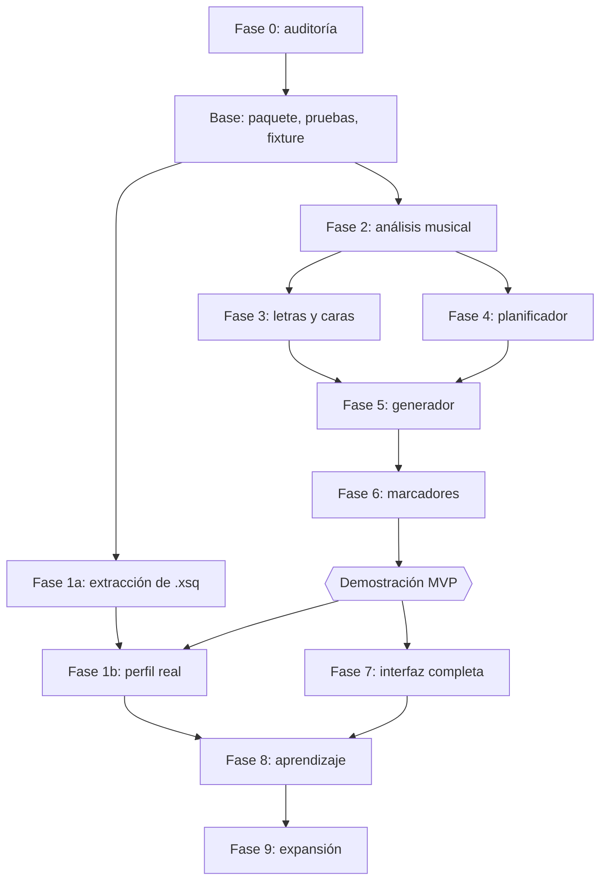

# Plan de implementación — Juajilandia Show Composer

## 1. Cambio respecto al orden original

**Propongo adelantar el MVP vertical (Fases 2, 3, 4, 5 y 6 en su versión mínima) a la Fase 1 completa.**

- La Fase 1 depende de tus `.xsq`, y no están disponibles en este equipo.
- Un perfil de estilo no se puede evaluar sin un generador que lo use.
- La demostración que pides en tu §17 no requiere aprender estilo.
- La Fase 1 mínima (solo la extracción) sí va antes del planificador, en paralelo, en cuanto tengamos los archivos.

El orden queda así:

**Regla de avance:** ninguna fase empieza hasta que la anterior cumpla todos sus criterios de aceptación.

## 2. Reglas de trabajo en cada fase

- Rama por fase, sobre `show-composer/fase-0`, en el fork `lluanllo/x-lights_fork`.
- Sin tocar `master`, que refleja upstream.
- Antes de ejecutar `build_catalog.py --update`, catálogo confirmado.
- Sin secuencias, audio comprado ni datos personales en el repositorio. Patrones que añadir a `.gitignore` en la Base.
- Al final de cada fase: línea en `README.txt` (AGENTS.md §10), fila de paridad y compilación.
- Cada `.cpp` nuevo en `xLights/xLights.vcxproj`, `.filters` y `xLights/xLights.cbp`.

## 3. Base técnica (antes de la Fase 2)

| Elemento | Detalle |
|---|---|
| Archivos nuevos | `src-core/composer/ComposerTypes.h`, `ComposerJson.h/.cpp` |
| Archivos a modificar | `CMakeLists.txt` (patrón `src-core/composer/*.cpp` en `SRC_CORE`), `xLights.vcxproj`, `.filters`, `.cbp`, `ci_scripts/check_core_include_boundaries.sh` |
| Pruebas | `xLights-Test/tests/composer_*_test.cpp`; workflow nuevo en el fork que compile y ejecute `xLights-Test` |
| Fixture | `xLights-Test/fixtures/composer-mini-show/`: `xlights_rgbeffects.xml` sintético (árbol, matriz, cara), audio generado por un script, sin material con licencia |

**Aceptación:**

- Una prueba vacía del Composer se ejecuta en CI del fork.
- La comprobación de capas cubre `src-core/composer`.
- La compilación Windows con Visual Studio y con CMake enlaza el paquete.

## 4. Fase 1 — Ingesta de shows

**Dividida en 1a (extracción) y 1b (perfil real).**

| | |
|---|---|
| Depende de | Base; para 1b, tus `.xsq` |
| Archivos nuevos | `ShowReference.h/.cpp`, `StyleProfile.h/.cpp` |
| Se reutiliza | `SequenceFile::Open`, `SequenceElements::LoadSequencerFile`, `AdjustEffectSettingsForVersion`, `Element::GetFileReferences`, recorrido de `ExportEffects` |
| Herramienta | Opción de desarrollo `--composer-analyze` |

**Pruebas:**

- Unitarias con un `.xsq` sintético de resultados conocidos.
- **Integridad:** SHA-256 de cada referencia, antes y después.
- Clasificación: un `Discarded` no altera el perfil; un `ApprovedFinal` pesa más que un `PurchasedDonor`.

**Aceptación:**

- Se procesan al menos 5 shows tuyos sin modificar ninguno.
- El informe coincide con lo observado a mano en 2 shows: efectos, duraciones, paletas.
- `shows finales` y `donantes` producen distribuciones separadas.
- El perfil resultante se puede editar a mano y vuelve a cargarse.

## 5. Fase 2 — Análisis musical

| | |
|---|---|
| Depende de | Base |
| Archivos nuevos | `SongAnalysis.h/.cpp`, y sus algoritmos |
| Se reutiliza | `AudioManager` (instancia privada), `ComputeOnsetEnvelope`, `DetectOnsets`, `DetectTempo`, `DetectChords`, `ComputeSpectrogram`, `GetFrameData`, filtros, `parallel_for` |
| Herramienta | `--composer-analyze-song <audio>`, que escribe JSON y un `.xtiming` |

**Pruebas:**

- Audio sintético con verdad conocida: clic a 120 BPM, cambio de 90 a 140 BPM, silencios, "secciones" de distinto timbre.
- Tolerancias: beats ±35 ms en sintético; tiempo total del análisis medido.
- Determinismo: dos ejecuciones, JSON idéntico.
- Cancelación: se detiene en menos de 2 s, sin fugas.

**Aceptación:**

- Tempo variable sintético: los beats siguen el cambio.
- En 5 canciones tuyas, tú revisas las secciones importadas al secuenciador. **Objetivo orientativo, a confirmar tras medir:** 4 de 5 con los límites de estribillo a menos de un compás.
- Nunca se bloquea la interfaz ni afecta a la reproducción abierta.
- La ausencia de voz o de estribillo se informa con baja confianza; no se inventa.

## 6. Fase 3 — Letras y caras

| | |
|---|---|
| Depende de | Fase 2 |
| Archivos nuevos | `LyricDocument`, `LyricAligner`, `SpanishPhonemizer` |
| Archivos a modificar | `src-core/lyrics/LyricBreakdown.h/.cpp` (extraer el reparto sin cambiar el comportamiento) |
| Se reutiliza | `ParseLRC`, `SanitizePhraseText`, `SequenceFile::Process*`, `PhonemeDictionary`, `FacesEffect` |

**Pruebas:**

- `SpanishPhonemizer`: tabla de palabras con acentos, `ch`, `ll`, `qu`, `gu`, `h` muda, `¿` y `¡`.
- Sílabas: tabla de palabras españolas.
- Regresión de `BreakdownWord`: misma salida antes y después de la extracción.
- `.xsq` real con pista de palabras como **verdad de referencia**: se mide la desviación de cada proveedor.

**Métrica, que se informará tal cual:** mediana y percentil 90 del error de inicio de frase y de palabra en 3 canciones
(inglés y español, incluyendo tu `Let It Snow`).

**Aceptación:**

- Una pista existente se reutiliza sin cambios.
- Ninguna palabra española queda sin fonemas.
- Toda palabra inglesa sin entrada aparece en el informe.
- Toda pista de baja confianza lo indica de forma visible.
- El modo de marcado manual permite sincronizar las frases de una canción en una sola escucha.
- **Decisión de producto al cerrar la fase:** con la métrica en la mano, decidir si el proveedor C basta como opción por defecto, o si
  el marcado manual debe ser el camino principal.

## 7. Fase 4 — Planificador

| | |
|---|---|
| Depende de | Fases 2 y 3 |
| Archivos nuevos | `ModelCapabilities`, `CompositionPlan` |
| Se reutiliza | `ModelManager`, `DisplayAsType`, `GetDefaultBufferWi`, `GetDefaultBufferHt`, `GetFaceInfo` |

**Pruebas:**

- Reglas duras como propiedades: un protagonista por segmento, sin efectos incompatibles, presupuestos respetados.
- Mismas entradas y semilla: plan idéntico, hash idéntico.
- Cambiar una sección no modifica las demás.
- Roles: tu layout real; `Ventana Matrix 1` es `Window`, no `Matrix`.

**Aceptación:**

- Plan válido para tu layout completo (57 modelos, 245 grupos) en menos de 5 s.
- Con los niveles `Conservative` y `Creative`, la diferencia es medible y respeta las reglas.
- El plan se lee en un informe legible y explica cada decisión.

## 8. Fase 5 — Generador

| | |
|---|---|
| Depende de | Fase 4 |
| Archivos nuevos | `Choreography`, `SequenceWriter`, `GenerationValidator`, `ComposerRunner`, `resources/composer/templates/*.json` |
| Archivos a modificar | `src-ui-wx/xLightsApp.cpp` (`--compose`) |
| Se reutiliza | `SequenceFile`, `SequenceElements`, `EffectLayer::AddEffect`, `AddNewTimingSection`, `SongStructureManager`, `HeadlessRenderContext`, `CheckEffectSettings` |

**Pruebas:**

- Validar **cada plantilla** contra `resources/effectmetadata/*.json`.
- **Ida y vuelta:** generar, guardar, reabrir, guardar de nuevo; `.xsq` estable y sin pérdida.
- Render real con `--headless` y código de salida 0.
- **`--fseqcmp` entre dos generaciones con la misma semilla: idéntico.** Las plantillas del MVP evitan efectos de física y shaders, porque
  AGENTS.md §4 los marca como no reproducibles.
- `CheckEffectSettings` sin errores en toda la secuencia.
- Nunca sobrescribe: prueba con el destino ya existente.
- Sin cambios: hash de `xlights_rgbeffects.xml` y `xlights_networks.xml`, antes y después.

**Aceptación:**

- La secuencia se abre en el secuenciador normal y se edita como cualquier otra.
- Renderiza en escritorio y en headless.
- Ningún canal de controlador cambia.

## 9. Fase 6 — Marcadores

| | |
|---|---|
| Depende de | Fase 5 |
| Archivos nuevos | `MediaCue`, `src-ui-wx/composer/ComposerReviewPanel` |
| Se reutiliza | `SequenceMedia`, `MakeRelativePath`, `VideoEffect`, `PicturesEffect`, `MediaCompatibility`, `UndoManager` |

**Investigación pendiente:** localizar la función de salto al tiempo en `MainSequencer`, y el reproductor de vista previa de vídeo.

**Pruebas:**

- Ningún `Video` con archivo vacío, en ninguna generación.
- Asignar: se crea un `Video` válido, se elimina la reserva y deshacer devuelve el estado anterior.
- Sidecar eliminado: la secuencia se abre y la pista conserva los marcadores.
- Etiquetas con acentos y comas: ida y vuelta sin pérdida.

**Aceptación:**

- Se ve en una lista qué falta y dónde.
- Un marcador se puede completar en menos de cuatro clics.
- `--headless` renderiza la secuencia antes y después de asignar.

## 10. Fase 7 — Interfaz completa en español

| | |
|---|---|
| Depende de | Fase 6 |
| Archivos nuevos | `src-ui-wx/composer/ShowComposerDialog`, `ComposerMessages` |
| Archivos a modificar | `src-ui-wx/xLightsMain.cpp` y `.h`, `resources/locale/es.po` |

**Pruebas:**

- Sin cadenas sin traducir en las pantallas nuevas: prueba del catálogo más revisión a mano con la interfaz en español.
- Coincidencia de `%` en cada `msgid` nueva.
- La interfaz en inglés sigue funcionando.
- **Prueba con el usuario final:** generar un show sin ayuda.

**Aceptación:**

- Una persona sin conocimientos técnicos llega del audio a la secuencia abierta, sin leer documentación.
- Cancelar en cualquier paso no deja archivos a medias.
- Filas de paridad actualizadas.

## 11. Fase 8 — Aprendizaje

| | |
|---|---|
| Depende de | Fase 1b, Fase 7 |
| Archivos nuevos | Comparador de plan y secuencia |

**Aceptación:**

- Un cambio único no genera ninguna propuesta.
- El mismo cambio en varias secciones o secuencias genera una propuesta con sus evidencias.
- Aceptar sube la versión del perfil; rechazar no vuelve a proponerlo.
- Tras aceptar, una nueva generación refleja la preferencia.

## 12. Fase 9 — Expansión

Solo cuando lo anterior sea fiable. En orden aproximado: varias voces, narraciones, biblioteca de medios, composición de varias canciones, eventos, escenas, plantillas avanzadas.

## 13. Resumen de pruebas

| Tipo | Dónde | Cuándo |
|---|---|---|
| Unitarias | `xLights-Test/tests/composer_*` | CI del fork |
| Propiedades del plan | `xLights-Test` | CI del fork |
| Integración | `--compose` + `--headless` + `--fseqcmp`, con el fixture | CI del fork (Windows) |
| Calidad en tus shows | Scripts locales, **fuera del repo** | Manual, por fase |
| Visual | Tú, con las luces o la vista de casa | Al cerrar cada fase |

## 14. Compilación en otras plataformas

AGENTS.md §11 exige macOS y la biblioteca iPad para cambios en el núcleo. Con un solo equipo Windows:

- **Windows:** verificado en cada fase.
- **Linux:** con `Ubuntu_CI.yml` en el fork, si los minutos de Actions lo permiten.
- **macOS e iPad:** **no verificado.** Mitigación: núcleo en C++20 portable, sin `#ifdef` de plataforma, y sin dependencias nuevas. Si quieres enviar esto a upstream, habrá que probarlo en un Mac.

## 15. Lo que necesito de ti para continuar

| Cuándo | Qué | Para qué |
|---|---|---|
| Fase 1 | Copia de `SHOW NAVIDAD` en este equipo, o la ruta | Análisis de estilo |
| Fase 1 | Clasificación de cada show | Referencia, comprado, final aprobado… |
| Fase 3 | Una canción en español con letra | Medir sincronización |
| Antes de la Fase 2 | Revisión de estos documentos y del MVP | Autorizar el desarrollo |
